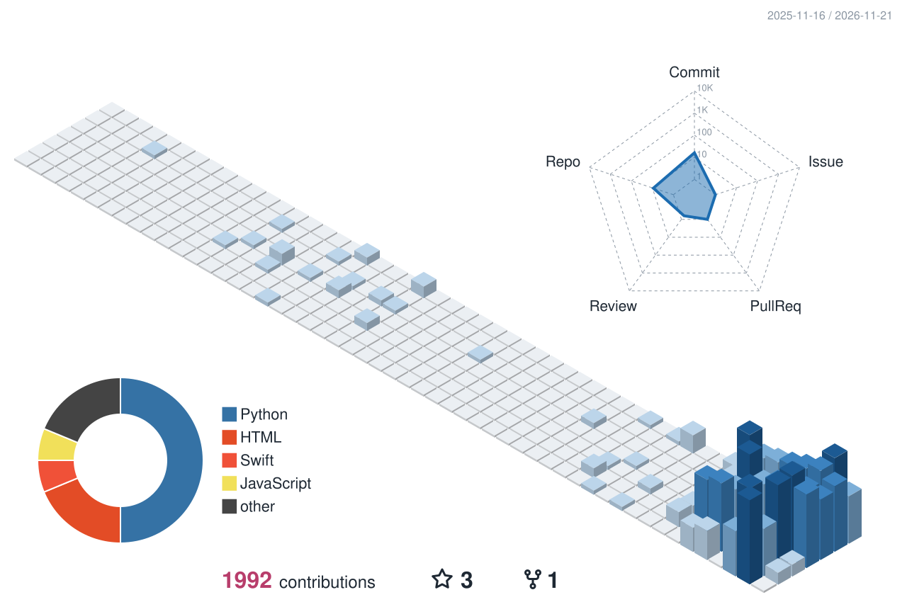

## 关于我 / About

我是 **7ing**，一名全栈工程师，专注于制造业里的工程软件。

主力项目是一套服务非标自动化企业的工程管理平台：从业务工单、工程 BOM 与工程变更，到询价定标、采购执行和仓储追溯，再到能在业务里办事、关键操作由本人确认的 AI 员工。我也做 AI 应用和活动类业务系统，比如 AI 面试教练和模联会议管理系统；平时还喜欢写一些把重复劳动交给程序的小工具。

I'm **7ing**, a full-stack engineer focused on software for manufacturing.

My main project is an engineering platform for custom-automation companies. It covers work orders, engineering BOMs and change control, sourcing and purchasing, and warehouse traceability, plus AI agents that do real work and wait for a person's sign-off on key actions. I also build AI products and event systems, such as an AI interview coach and a Model UN conference platform, and I write small tools that hand repetitive chores over to code.

## 技术栈 / Stack

  

## 明细栏 / Selected work

| 序⁠号 No. | 项目 Project | 说明 What it does | 技术 Stack |
| :-: | --- | --- | --- |
| 1 | **工程管理平台** Engineering platform (private) | 为非标自动化企业打造：工单、工程 BOM 与变更、采购、仓储和 AI 员工；约 35 万行代码（含 9.7 万行测试），1,200+ 次提交、362 个合并 PR、47 个版本 For custom-automation companies: work orders, BOMs and change control, purchasing, warehouse and AI agents. About 350k lines of code (97k in tests), 1,200+ commits, 362 merged PRs, 47 releases. | Go, React, TypeScript, MySQL, Valkey, Docker |
| 2 | **AI 面试教练** AiInterview (private) | 模拟面试时语音作答实时转文字，点评流式返回，配套学习模块与向量知识库；约 2.7 万行代码 Answer mock interviews by voice with live speech-to-text, get streamed feedback, then keep learning with a pgvector knowledge base. About 27k lines of code. | React 19, TypeScript, Go, Gin, PostgreSQL, pgvector |
| 3 | **会议管理系统** Mercury (private) | 为 YOUMUNC 模拟联合国活动打造：报名、组队、学术测试与面试、在线支付到席位分配全流程线上办理；5 万+ 行代码 Runs YOUMUNC Model UN events end to end: sign-up, teams, academic tests and interviews, payments and seat allocation. 50k+ lines of code. | Vue 3, Element Plus, Flask, MySQL |
| 4 | [**EyeMirror 眸镜**](https://github.com/7innng/EyeMirror) | 树莓派智能魔镜，内置视力检测，配套微信小程序 A Raspberry Pi smart mirror with a built-in vision test and a WeChat mini program. | Python, Raspberry Pi |
| 5 | [**sandboxie-guardian**](https://github.com/7innng/sandboxie-guardian) | 监控多开沙盒里的进程，异常退出后自动重启 Watches apps across Sandboxie instances and restarts them when they crash. | Python |
| 6 | [**srun-login-http**](https://github.com/7innng/srun-login-http) | 用纯 HTTP 请求完成深澜校园网登录、下线与保活 Logs in to SRun campus networks and keeps you online over plain HTTP, no browser needed. | Python |
| 7 | [**excel-word-filler**](https://github.com/7innng/excel-word-filler) | 按表头把 Excel 数据填进 Word 模板，原有样式一处不变 Fills Word table templates from Excel by column name and keeps every style intact. | Python, python-docx |
| 8 | [**openclaw-knowledge-base**](https://github.com/7innng/openclaw-knowledge-base) | 脱敏后的 AI 助手身份、准则与工具配置模板 Sanitized identity, guideline and tool templates for an AI assistant. | Markdown |

## 开源贡献 / Open source

| 项目 Project | 贡献 Contribution | 状态 Status |
| --- | --- | :-: |
| [**dofastted/vm2api**](https://github.com/dofastted/vm2api)  | [#1022 修复 Pro 账号 Fable 额度的展示](https://github.com/dofastted/vm2api/pull/1022)：详情页、列表和机架按真实窗口读数显示用量，区分 0% 与未探测，号池额度计入 Pro 窗口；13 个文件，+187 / −94，通过 23 项相关测试 Fixed how Fable quota shows for Pro accounts: real window readings across the detail, list and rack views, a clear split between 0% and not probed, and pool capacity that counts Pro windows. 13 files, +187 / −94, verified by 23 related tests. | 已合并 Merged |

## 贡献 / Activity

  

